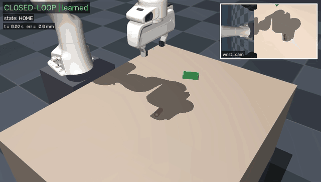

# 🦾 Closed-Loop Pick-and-Place: Vision-Based Recovery with a Franka Panda

**A MuJoCo simulation benchmark in which a robot arm picks and places a small capsule using only learned RGB-D camera estimates, and must detect and recover when the world is disturbed.**

<p align="center">
  
  
  
  
  
  
  
</p>

Two simulated RGB-D cameras, one on the wrist and one overhead, watch a table holding a capsule and a small open-topped fixture. A small learned U-Net per camera segments the objects, and noisy depth turns the masks into 3D poses. A state-machine controller picks up the capsule and places it fully inside the fixture. The controller sees only camera estimates and its own joint state. Simulator ground truth is used only to score the result.

The research question is whether the controller can **notice and recover from disturbances**. The hardest case is the fixture being moved just after the gripper opens. The capsule then ends up jammed against a wall and must be pushed back to the centre using camera evidence alone.

---

## 🎬 Simulation demo



*shown at 2x speed.*

## 🎯 Goal of the work

The goal is a **closed-loop placement controller that checks its own work** and supports:

- **Learned perception:** per-camera RGB-D segmentation with geometric pose estimation, no simulator state.
- **Disturbance detection:** notice arm pushes, capsule nudges and fixture moves from camera evidence.
- **Safe recovery:** re-plan, re-grasp or push the capsule back into place without hitting the fixture or table.
- **Honest scoring:** a placement counts only if the whole capsule footprint is settled inside the fixture.
- **Reproducibility:** each controller revision is frozen and audited against the one before it.

## ✨ Features

| Feature | What it does |
| --- | --- |
| Learned RGB-D perception | Two TinyUNet specialists (wrist_cam, top_cam, 488k parameters each) produce masks. Depth and calibrated cameras give 3D poses. |
| Isolated inference worker | PyTorch runs in a separate CPU process that checks its code and model files are unmodified (by comparing file fingerprints) before loading. |
| Closed-loop task state machine | Approach, grasp, lift, carry, place, release, settled inspection and recovery, each gated on fresh observations. |
| Scheduled disturbances | Arm pushes, capsule nudges and fixture moves, generated by seed so every controller sees identical events. |
| Settled inspection | After release, a full-footprint check with a 0.4 s settling window decides success. |
| Recovery centering | Pushes a jammed capsule back to the centre with a bounded stroke, confirmed alarms and a hand-occlusion gate. |
| Collision-aware scoring | Any robot-fixture or robot-table contact is recorded and fails the episode. |
| Interactive viewer | Push the arm, nudge the capsule or drag the fixture live with the mouse or keyboard. |

## 🧰 What we used

| Component | Technology | Role in this project |
| --- | --- | --- |
| Physics simulator | MuJoCo 3.15 | Rigid-body dynamics, contacts, rendered RGB-D cameras. |
| Robot model | Franka Panda (MuJoCo Menagerie) | 7-DoF arm with a parallel gripper. |
| Controller | Python + NumPy | State machine, inverse kinematics, grasp planning, recovery logic. |
| Perception model | PyTorch TinyUNet (CPU) | Capsule and fixture segmentation from RGB-D images. |
| Image and geometry | OpenCV + NumPy | Mask processing, depth back-projection, pose fitting. |
| Configuration | YAML + JSON protocols | Base profiles, plus one frozen protocol per controller revision. |
| Testing | pytest | 217 unit and integration tests. |

The checkpoints were trained on synthetic MuJoCo renders. They are included for inference at `training/results/kaggle_specialization_v3_seed17/`, and `training/candidate_specialists_v3.json` records their fingerprints. The training package `training/perception_training/` is included because the worker checks it too.

## 🧩 How it works

1. **See.** Each control tick, the cameras render RGB-D frames. The worker segments the capsule and fixture, and depth gives a 3D pose with a capture timestamp.
2. **Plan and grasp.** The controller chooses a grasp from the estimated capsule pose and known gripper geometry, then approaches, closes and lifts.
3. **Carry.** A carrying guard checks that the capsule is still in the hand. If a check fails, the controller aborts and recovers.
4. **Place and release.** The controller lowers the capsule over the estimated fixture position and opens the gripper.
5. **Inspect.** It re-observes the settled scene. Success needs the whole capsule footprint inside the fixture, at rest, with the gripper open and no robot contact.
6. **Recover.** If the fixture moved and the capsule is jammed against a wall, the controller plans a centering push from a clear, fresh view. The push may finish without fresh capsule evidence, but only within a short stroke, a time budget and the fixture guards. A capsule-displacement alarm needs two agreeing detections, and detections seen through the robot's own hand are ignored.

**Autonomy scope:** the controller never reads simulator object state. It uses camera estimates, its own joint state and known CAD geometry of the robot, capsule and fixture.

## 🏠 Simulation environment

| Property | Value |
| --- | --- |
| Robot | Franka Panda, 7 joints plus parallel gripper |
| Object | Capsule, 8 mm radius, 15 mm half-length |
| Destination | Open-topped fixture with 10 mm walls on a table at z = 0.4 m |
| Cameras | `wrist_cam` (on the hand) and `top_cam` (overhead), both RGB-D |
| Disturbances | Arm push, capsule nudge, fixture move (late, mid-phase, or just after release) |
| Episode budget | 30 s simulated time |

Scene poses are drawn from the seed, so the same seed gives the same scene and disturbance for every controller.

## 📁 Project structure

```text
closed-loop-pick-place/
├── run_v24.py                   # Single headless episode of the final v24 controller
├── run_demo.py                  # Interactive MuJoCo viewer
├── run_eval.py                  # Batch evaluation of the earlier controllers
├── run_record.py                # Record episodes to video
├── src/cl_pickplace/            # Simulation and controller
│   ├── sim.py, sensors.py       # MuJoCo scene, cameras and depth noise
│   ├── episode.py               # Episode loop, disturbances and scoring
│   ├── task_fsm.py              # Base pick-and-place state machine
│   ├── learned_perception.py    # Client for the CPU inference worker
│   ├── settled_inspection.py    # Post-release footprint check
│   ├── bounded_blind_centering.py     # v22
│   ├── confirmed_blind_centering.py   # v23
│   ├── occlusion_gated_centering.py   # v24
│   └── ...                      # Grasp planning, retention, recovery modules
├── scripts/                     # Configuration chain each revision builds on
├── config/                      # YAML profiles, per-revision protocols, hand envelope
├── training/                    # Inference workers, pose geometry, model, checkpoints
├── assets/scene.xml             # Table, capsule and fixture scene
├── third_party/mujoco_menagerie/franka_emika_panda/   # Robot model (Apache-2.0)
├── tests/                       # pytest suite (217 tests)
├── requirements.txt             # Simulation dependencies
└── requirements-tested-windows.txt   # Exact tested package versions
```

Episode logs, videos and caches are written under `results/` and `videos/`, which Git ignores.

## ⚙️ Setup on Windows

**Prerequisites:** Python 3.14 for the simulation and Python 3.12 for the perception worker. Tested on Windows 11.

Open PowerShell **inside the project folder** and create both environments:

```powershell
# 1. Simulation environment
py -3.14 -m venv .venv
.\.venv\Scripts\python.exe -m pip install -r requirements.txt

# 2. Perception worker: must live at training\.venv-cpu
py -3.12 -m venv training\.venv-cpu
.\training\.venv-cpu\Scripts\python.exe -m pip install -r training\requirements.txt
```

The worker was tested with torch 2.14.1+cpu and numpy 2.3.5. The checkpoints are already included, so no training or dataset is needed.

On Linux or macOS, set `worker_python` in the `config/*.yaml` files to `training/.venv-cpu/bin/python`.

> **Keep line endings unchanged.** `.gitattributes` sets `* -text` because the worker fingerprint-checks its files. Converting line endings will make it refuse to load.

## ▶️ Run the simulation

**One headless v24 episode.** The conditions are `nominal`, `late`, `phase` and `release_phase`:

```powershell
.\.venv\Scripts\python.exe run_v24.py --seed 605 --condition release_phase
```

This should print a success in 20.2 simulated seconds with 4.37 mm minimum clearance. Add `--method confirmed_v23` to compare against v23, or `--json` for the full record.

**Watch it in the viewer:**

```powershell
.\.venv\Scripts\python.exe run_demo.py --config config/learned.yaml --perception learned
```

| Key | Action |
| --- | --- |
| `S` | Move the fixture (a later move replaces the previous one) |
| `P` | Push the arm |
| `O` | Nudge the capsule (when not grasped) |
| `R` | Reset to a new random scene |
| `V` | Cycle camera / learned / ground-truth perception |
| `F8` | Toggle closed-loop / open-loop on the next reset |
| `Space` | Pause or resume control |
| Double-click + Ctrl-drag | Select a body and push or move it with the mouse |

CPU inference runs in lockstep with the physics, so an episode takes about 20 to 60 s of wall time. It is not real time.
